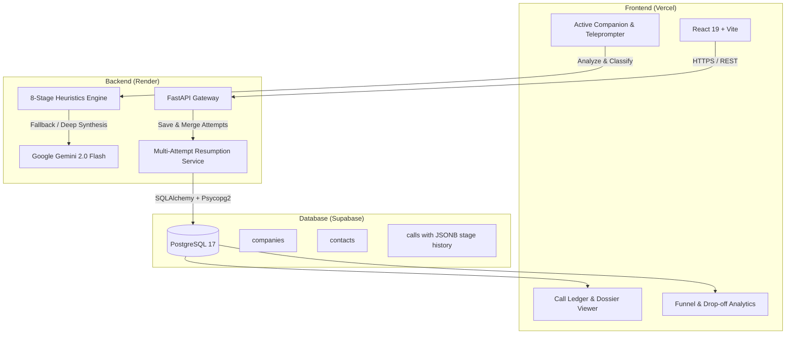

# 📞 CallerLog AI — Real-Time Cold Calling Intelligence & 8-Stage Pipeline

[](https://fastapi.tiangolo.com)
[](https://react.dev)
[](https://supabase.com)
[](https://render.com)
[](https://vercel.com)
[](https://ai.google.dev)

> **Enterprise-grade Cold Calling Companion, Resumption Engine, and 8-Stage Funnel Intelligence Platform built for Meridian Growth Partners.**

---

## 🌟 Executive Summary

In fast-paced B2B cold calling, sales development representatives (SDRs) have less than 30 seconds to capture attention, navigate gatekeepers, qualify intent, and lock in next steps. When calls end prematurely (e.g., *"I'm walking into a meeting, call back in an hour"*), reps lose conversational momentum, stage progress is lost, and CRM data becomes stale.

**CallerLog AI** solves this with:
1. **Real-Time Active Companion**: Dual-pane teleprompter guiding callers through an 8-stage cold-call framework with live objection battlecards.
2. **Context-Aware Resumption Pipeline**: Intelligently marks interrupted calls as `ACTIVE`, bridges prior context, and resumes teleprompter cues directly from the exact next unreached stage.
3. **8-Stage Drop-Off Funnel**: Visual analytics comparing live team performance against a benchmark of 100 pre-loaded B2B cold-call transcripts.
4. **Cloud-Native Architecture**: Zero-setup production deployment connecting Vercel, Render, and Supabase PostgreSQL with real-time sync.

---

## 🏗️ System Architecture



---

## 🎯 The 8-Stage Meridian Cold Call Framework

Every call is evaluated against Meridian Growth Partners' tested sales framework:

| Stage # | Stage Name | SDR Objective | Key Signals & Presets |
| :---: | :--- | :--- | :--- |
| **1** | **Introduction** | Pattern interrupt, identify caller identity. | *"Hi [Prospect], Priya from Meridian..."* |
| **2** | **Context & Purpose** | Why you are calling today; frame the thesis. | Context established, reference industry focus. |
| **3** | **Permission / Soft Buy-in** | Earn 30 seconds of attention; reduce defensiveness. | *"Did I catch you at a bad time?"* / Permission granted. |
| **4** | **Discovery & Qualification** | Determine company size, leadership role, division fit. | Validated decision-maker role, confirmed operating scale. |
| **5** | **Need Identification** | Surface pain point; record verbatim business requirement. | Extracted explicit customer need (stored as verbatim text). |
| **6** | **Pitch & Objection Handling** | Deliver core value prop; deploy counter-battlecard. | Overcame vendor lock-in, timing, or authority hesitation. |
| **7** | **Next Step & Agreement** | Secure low-friction commitment (WhatsApp 2-pager / meeting). | Specific date, time, and channel agreed upon. |
| **8** | **Wrap-up & Close** | Confirm details, close call politely and professionally. | Final confirmation given, contact details verified. |

---

## ⚡ Core Features & Walkthrough

### 1. Active Companion (Live Calling Mode)
- **Dual-Pane Interface**: Left side houses live transcript feed and caller/prospect dialogue; right side provides the synchronized 8-stage visual progress tracker.
- **Dynamic Teleprompter**: Shows exact talk-track guidance for the active stage.
- **Objection Battlecards**: Real-time counter-strategies for common objections (*"Send an email"*, *"We already have a vendor"*, *"Not interested"*).
- **One-Tap Tags**: Reps can tap quick-capture tags for instant turn logging without breaking conversational flow.

### 2. Intelligent Mid-Call Drop & Resumption Flow
- **Early Disconnect Detection**: If a call ends before Stage 7/8 without a hard terminal outcome (*wrong person*, *do not call*), the call is flagged as **`ACTIVE` (Unfinished)**.
- **Single-Click Resumption**: In the Call Ledger, reps click **Resume Call** to immediately re-engage.
- **Smart Context Bridging**: 
  - Advances teleprompter to the next uncompleted stage (e.g., resumes at Stage 6 if previously dropped at Stage 5).
  - Pre-loads past verbatim notes and provides a tailored callback bridge (*"Hi [Name], when we spoke earlier you mentioned..."*).
- **Unified Multi-Attempt History**: Upon final closing, the backend merges attempts into one consolidated record (`attempt_count: 2`), preserves full 8-stage completion, and prevents duplicate transcript bloat.

### 3. Call Intelligence Ledger
- Search, filter, and inspect all logged calls with sub-second query performance.
- Filter by **Outcome** (*Next Step Agreed*, *Interested*, *Follow Up*, *Not Interested*), **Stage Reached**, or **Call Status** (*Active* vs. *Closed*).
- Inspect full Post-Call Dossiers, including verbatim prospect needs, objection breakdowns, and Next Step commitments.

### 4. 8-Stage Funnel & Drop-off Intelligence
- Visualizes the conversion drop-off percentage at each transition point across all 8 stages.
- Pinpoints the team's primary conversational friction point (e.g., Stage 3 permission drop-offs vs. Stage 6 objection drop-offs).
- **Dual Benchmark View**: Toggle between **Live Database** (your production Supabase calls) and **100 Benchmark Transcripts** (historical baseline dataset).

---

## 🛠️ Technology Stack

| Layer | Technology | Key Highlights |
| :--- | :--- | :--- |
| **Frontend** | React 19, Vite, Lucide Icons | Glassmorphic design, zero-dependency vanilla CSS, responsive SPA routing |
| **Backend** | Python 3.11, FastAPI, Uvicorn | Async route handlers, Pydantic v2 schemas, automated CORS handling |
| **AI & NLP** | Google Gemini 2.0 Flash + Custom Heuristics | Sub-50ms regex/keyword classification with Gemini fallback for deep synthesis |
| **Database** | Supabase (PostgreSQL 17) | Shared IPv4 pooler, UUID primary keys, JSONB stage snapshots, RLS policies |
| **Deployment** | Render (Web Service), Vercel (SPA) | Fully automated CI/CD pipeline on git push to `main` |

---

## 🚀 Quickstart & Local Development

### Prerequisites
- Python 3.11+
- Node.js 18+ and `npm`
- Git

### 1. Clone Repository
```bash
git clone https://github.com/Lucky-0512/callerlog.git
cd callerlog
```

### 2. Backend Setup
```bash
# Navigate to backend directory
cd backend

# Create and activate virtual environment
python -m venv .venv
source .venv/bin/activate  # On Windows: .venv\Scripts\activate

# Install dependencies
pip install -r requirements.txt

# Create environment configuration
cp .env.example .env
```

Configure `backend/.env`:
```ini
DATABASE_URL=postgresql+psycopg2://postgres.<project-ref>:<password>@<pooler-host>:5432/postgres
GEMINI_API_KEY=your_gemini_api_key_here
GEMINI_MODEL=gemini-2.0-flash
CORS_ORIGINS=http://localhost:5173,http://localhost:3000,*
```

Start the FastAPI development server:
```bash
uvicorn app.main:app --host 127.0.0.1 --port 8000 --reload
```
API Documentation will be live at `http://127.0.0.1:8000/docs`.

### 3. Frontend Setup
In a new terminal window:
```bash
cd frontend
npm install
npm run dev
```
Open `http://localhost:5173` in your browser.

---

## ☁️ Production Deployment

### 1. Render Deployment (FastAPI Backend)
1. Link your GitHub repository in the **Render Dashboard**.
2. Select **Web Service** with the following settings:
   - **Runtime**: `Python 3`
   - **Build Command**: `pip install -r requirements.txt`
   - **Start Command**: `uvicorn main:app --host 0.0.0.0 --port $PORT`
3. Add Environment Variables:
   - `DATABASE_URL`: Your Supabase pooler connection URI.
   - `GEMINI_API_KEY`: Google Gemini API key.
   - `CORS_ORIGINS`: `*` (or your Vercel URL).

### 2. Vercel Deployment (React Frontend)
1. Import repository in **Vercel**.
2. Set **Root Directory** to `frontend`.
3. Add Environment Variable:
   - `VITE_API_BASE_URL`: `https://<your-render-service>.onrender.com/api` (Set Type to **Plain Text / Config**).
4. Click **Deploy**.

---

## 📊 Database Schema (Supabase PostgreSQL)

```sql
-- Relational Schema for Companies, Contacts, and Multi-Attempt Calls
CREATE EXTENSION IF NOT EXISTS "uuid-ossp";

CREATE TABLE IF NOT EXISTS companies (
    id UUID PRIMARY KEY DEFAULT uuid_generate_v4(),
    name VARCHAR(255) NOT NULL,
    company_kind VARCHAR(100) DEFAULT 'not known',
    industry VARCHAR(100),
    created_at TIMESTAMP WITH TIME ZONE DEFAULT timezone('utc'::text, now()) NOT NULL
);

CREATE TABLE IF NOT EXISTS contacts (
    id UUID PRIMARY KEY DEFAULT uuid_generate_v4(),
    company_id UUID REFERENCES companies(id) ON DELETE SET NULL,
    full_name VARCHAR(255) NOT NULL,
    role_title VARCHAR(255) DEFAULT 'not known',
    phone_number VARCHAR(50),
    email VARCHAR(255),
    created_at TIMESTAMP WITH TIME ZONE DEFAULT timezone('utc'::text, now()) NOT NULL
);

CREATE TABLE IF NOT EXISTS calls (
    id UUID PRIMARY KEY DEFAULT uuid_generate_v4(),
    call_id VARCHAR(100),
    call_id_status VARCHAR(50) DEFAULT 'ACTIVE',
    attempt_count INTEGER DEFAULT 1,
    company_id UUID REFERENCES companies(id) ON DELETE SET NULL,
    contact_id UUID REFERENCES contacts(id) ON DELETE SET NULL,
    caller_name VARCHAR(100) NOT NULL,
    duration_seconds INTEGER DEFAULT 0,
    max_stage_number INTEGER NOT NULL DEFAULT 1,
    max_stage_name VARCHAR(50) NOT NULL,
    outcome VARCHAR(50) NOT NULL DEFAULT 'not_logged',
    stage_5_need_verbatim TEXT,
    objection_summary TEXT,
    next_step_action VARCHAR(255),
    next_step_date_time VARCHAR(100),
    next_step_channel VARCHAR(50),
    where_you_left_off_summary TEXT,
    suggested_callback_bridge TEXT,
    stage_analysis JSONB DEFAULT '[]'::jsonb,
    raw_transcript TEXT NOT NULL,
    call_timestamp TIMESTAMP WITH TIME ZONE DEFAULT timezone('utc'::text, now()) NOT NULL
);
```

---

## 📡 REST API Reference

| Method | Endpoint | Description |
| :--- | :--- | :--- |
| `GET` | `/` | Health check, DB engine status, and AI config check. |
| `GET` | `/api/transcripts` | Fetch index of pre-loaded benchmark cold-call transcripts. |
| `GET` | `/api/transcripts/{id}` | Retrieve detailed transcript turns and stage classifications. |
| `POST` | `/api/analysis/analyze` | Run real-time 8-stage classification & battlecard generation. |
| `GET` | `/api/calls` | Fetch filtered call ledger records from Supabase. |
| `POST` | `/api/calls/save-reviewed` | Save or resume/merge multi-attempt call record. |
| `DELETE` | `/api/calls/{id}` | Remove call record from database. |
| `GET` | `/api/analytics/overview` | Compute 8-stage drop-off funnel & outcome distributions. |

---

## 👥 Authors & Acknowledgments

- **Lead Developer**: Kushal ([@Lucky-0512](https://github.com/Lucky-0512))
- **Organization**: Meridian Growth Partners Cold Calling Team
- **Evaluator Reference**: Built for real-world enterprise sales acceleration and AI-assisted conversational excellence.
